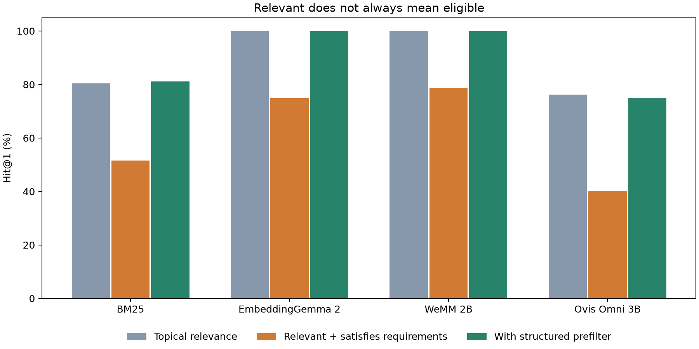

# EmbeddingGemma 2 can find the right topic and still violate your requirement

An offline assistant searches for instructions to index PDF manuals. The query says network access is forbidden. The first result describes the right task, but requires a network connection.

That happened in this experiment with EmbeddingGemma 2. The invalid procedure scored 0.83734; the otherwise matching offline procedure scored 0.83128. Semantic similarity was a useful relevance signal, but the highest score did not enforce the operational condition.

I compared three recent models on a fictional deployment catalog: EmbeddingGemma 2, WeMM-Embedding-2B and Ovis-Omni-Embedding-3B. Each of 864 requirement queries ranked eight candidates. The requirements covered negation, conjunctions, numeric limits, dates, transfer direction and runtime versions. Another 144 queries measured ordinary topical retrieval.

Gemma chose the right topic on every requirement query, yet only 74.88% of its first results also satisfied the requirement. WeMM reached 78.70%, again with 100% topical relevance. Ovis reached 40.28%, but also struggled with topic relevance, making its result less diagnostic of logic alone. These are results for this controlled text baseline, not a universal model ranking.

For on-device architecture, the more interesting result appeared when the vectors got smaller. Gemma's 128-dimensional vectors kept all ordinary topical controls correct. Requirement satisfaction nevertheless fell from 74.88% to 66.67%. WeMM showed the same pattern: its controls stayed perfect while requirement accuracy dropped from 78.70% to 66.90%.

A compression evaluation that looked only at the easy controls would have missed this. Gemma's raw FP32 vector payload shrank sixfold, from 3,072 to 512 bytes per item, but an operationally meaningful quality measure degraded. These byte counts exclude the model, metadata and index overhead.

The experiment also compared where eligibility filtering happens. With correct structured facts supplied by the catalog, prefiltering recovered all 864 cases for native Gemma and WeMM. Filtering only their top three results left 26 and 19 queries, respectively, with no eligible result. A filter cannot recover candidates already removed from a shortlist.

Even with 128-dimensional vectors, prefiltering reached 99.31% for Gemma and 100% for WeMM. That offers a practical design hypothesis: keep hard eligibility fields in a local structured store, use them to narrow candidates, and let compact embeddings rank the eligible set. The important condition is reliable metadata. This experiment did not solve extracting requirements from arbitrary language.

I also ran the complete NevIR test split as an exploratory external check. Gemma got 55.13% of individual queries right, but only 13.74% of pairs had both answers correct. WeMM scored 58.57% and 19.67%; Ovis scored 49.86% and 12.15%. Independently random rankings have a 25% expected pair score. Preferring one document across opposing queries can look tolerable per query while failing the pair.

The broad weakness is already known from [NevIR](https://arxiv.org/abs/2305.07614) and multi-condition retrieval research. The useful contribution here is fresh evidence connecting recent embedding models, compact vectors and filter placement. It gives architects a concrete measurement to add before selecting an on-device retrieval design: can the system preserve requirements, including when they reverse, after reducing vector storage?

These were BF16 runs on one Intel GPU, with exact normalized-vector scoring and no speed optimization. The dataset is synthetic, the metadata is perfect, and this evaluates text retrieval rather than complete assistant behavior. Ovis's loading adaptation and fixed instruction are disclosed. The [research report](REPORT.md) includes full results, uncertainty, limitations and links to the data and reproduction scripts.
