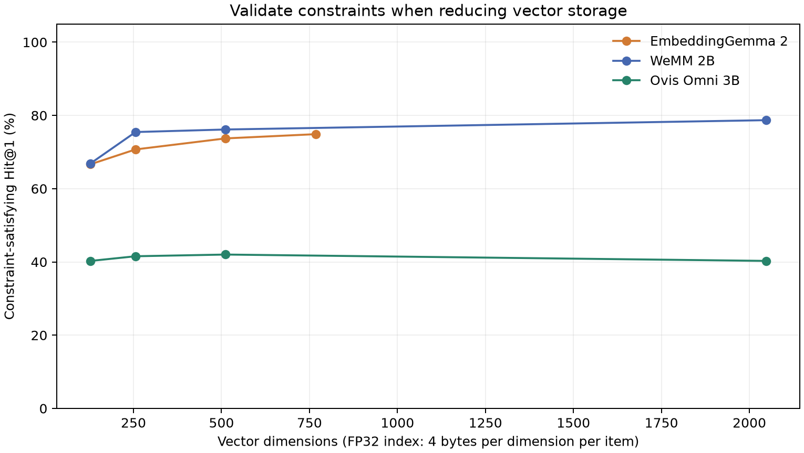

# Requirement satisfaction in recent embedding models

EmbeddingGemma 2 and WeMM retrieved a document about the correct topic on every one of 864 requirement queries, yet their first result violated the stated requirement in 25.12% and 21.30% of cases. This controlled deployment-catalog study distinguishes semantic relevance from eligibility: an offline procedure, a memory limit, or a transfer direction must hold even when several candidates describe the same task.

The most useful on-device finding is a mismatch between evaluation signals. Reducing Gemma vectors from 768 to 128 dimensions left all 144 ordinary topical controls correct, while requirement-satisfying Hit@1 fell from 74.88% to 66.67%. Topical controls alone would miss that degradation. With supplied, correct structured facts, filtering before ranking recovered 99.31% at 128 dimensions.

## Models and execution

The comparison uses [Google EmbeddingGemma 2](https://huggingface.co/google/embeddinggemma-2), [Tencent WeMM-Embedding-2B](https://huggingface.co/tencent/WeMM-Embedding-2B), and [Ovis-Omni-Embedding-3B](https://huggingface.co/ATH-MaaS/Ovis-Omni-Embedding-3B). These are contemporary multimodal releases with a common text-retrieval interface. Release context, prior work and immutable revisions are recorded in [SOURCES.md](SOURCES.md) and [model-discovery.json](model-discovery.json). This is a text-only use-case diagnosis, not a size-controlled or multimodal leaderboard.

All six completed runs, including external validation, placed model parameters on physical Intel GPU 0 through `ZE_AFFINITY_MASK=0` and `xpu:0`. The hardware inventory identifies Intel Battlemage G31 devices with approximately 32 GB each. BF16 model inference produced FP32 normalized vectors; scoring used exact dot products. No approximate index, finetuning, quantization or reranker was used. WeMM had a framework CPU fallback for triangular solve, so this is not evidence that every operation ran on the GPU. The experiment makes no throughput or energy claims.

Gemma used its text-only encoder configuration and SearchQuery/Document prompts. WeMM used its released Sentence Transformers module. Ovis used the released Thinker backbone, native chat formatting and last-valid-token pooling. Its generic query instruction and loading adaptation are disclosed in [RUNTIME_NOTES.md](RUNTIME_NOTES.md). Ovis had weak topical controls, so its failures cannot all be attributed to logical constraints; the result describes this baseline configuration, not a general capability ranking.

## Controlled catalog experiment

The frozen dataset contains 1,152 fictional documents, 864 constraint queries and 144 topical controls. Each query ranks eight candidates, covering four factual variants of the desired topic and four of another topic. Twelve topic worlds, six requirement families, prose/field representations, two requirement variants and three paraphrases make the comparison systematic. Every method uses the same candidates and order. Success means the first result is both topically relevant and satisfies every required predicate. Multiple valid answers are accepted.

The structured-filter baselines receive correct predicates and facts from the synthetic generator. They do not read relevance labels or topic IDs. They still have to rank among eligible documents about different topics. This isolates filter placement, assuming eligibility information is already available from a UI and catalog. It does not evaluate extracting reliable predicates or facts from arbitrary prose.

| Method | Relevant and eligible at rank 1 | Topic correct at rank 1 | Topical controls | Structured prefilter | Top 3 then filter |
|---|---:|---:|---:|---:|---:|
| EmbeddingGemma 2 | 74.88% | 100.00% | 100.00% | 100.00% | 96.99% |
| WeMM-Embedding-2B | 78.70% | 100.00% | 100.00% | 100.00% | 97.80% |
| Ovis-Omni-Embedding-3B | 40.28% | 76.27% | 52.08% | 75.12% | 65.51% |
| BM25 | 51.50% | 80.44% | 77.08% | 81.13% | 73.26% |
| Seeded random | 21.64% | 51.97% | 47.92% | 50.23% | 40.28% |

Whole-topic bootstrap intervals for requirement-satisfying Hit@1 are 73.61–76.62% for Gemma, 76.74–80.90% for WeMM and 35.19–45.49% for Ovis. These use 2,000 resamples of 12 complete worlds, preserving correlated paraphrases and representations. They describe variation within this small template design, not uncertainty over real production traffic. The full breakdowns and metrics are in [summary.json](results/summary.json).

Gemma succeeded on 647/864 constraint queries; WeMM on 680/864. Both always selected the correct topic. In these two runs the failures therefore isolate eligibility among semantically close alternatives. Filtering only the top three left Gemma without an eligible result on 26 queries and WeMM on 19. Prefiltering recovered all 864 for both. Once the shortlist discards valid candidates, filtering cannot restore them.

## Failure families and a concrete example

| Requirement family | Gemma | WeMM | Ovis |
|---|---:|---:|---:|
| conjunction | 61.81% | 72.92% | 33.33% |
| negation | 75.69% | 82.64% | 47.22% |
| numeric | 50.00% | 56.25% | 38.89% |
| role binding | 61.81% | 63.89% | 27.08% |
| temporal | 100.00% | 100.00% | 33.33% |
| version | 100.00% | 96.53% | 61.81% |

Gemma was particularly weak on numeric thresholds, conjunctions and source/destination binding. The temporal and version templates yielded ceiling or near-ceiling results for Gemma and WeMM. Their lexical cues make those rows easy; they do not establish general interval or semantic-version reasoning.

For the query “Retrieve instructions to build a searchable index of PDF instruction books with network access forbidden,” Gemma ranked “Procedure to index PDF manuals. A network connection is required. No device reboot is required.” at cosine 0.83734. The valid variant, with “No network connection is required,” scored 0.83128. The highest similarity selected the opposite operational condition. This is an illustrative failure from the full saved set, not a randomly selected estimate of typical behavior. See [failure-examples.json](results/failure-examples.json).

Paired variant success requires both requirement variants to retrieve correctly within the same topic, family, representation and paraphrase. It was 50.69% for Gemma and 59.49% for WeMM, lower than their individual-query scores. The version variants are nested thresholds rather than opposites, so this metric should not be called pure negation accuracy.

## Vector storage can hide requirement degradation

| Model | Native dimensions and accuracy | 512 dimensions | 256 dimensions | 128 dimensions |
|---|---:|---:|---:|---:|
| Gemma | 768 / 74.88% | 73.73% | 70.72% | 66.67% |
| WeMM | 2048 / 78.70% | 76.16% | 75.46% | 66.90% |
| Ovis | 2048 / 40.28% | 42.01% | 41.55% | 40.28% |

Gemma and WeMM use supported prefix truncation followed by normalization. Ovis uses the released learned projection matrices followed by normalization; slicing its vectors would be a different method. The Ovis projection comparison was added after initial Gemma inspection and is exploratory.

At FP32, Gemma's raw vector payload falls from 3,072 to 512 bytes per document: a sixfold reduction. For one million documents, that is 3.072 GB versus 0.512 GB in decimal units, excluding metadata, indexing overhead and model weights. This is calculated storage, not a device-memory benchmark.

Gemma's ordinary controls remained 100% correct at every tested width. WeMM's controls did too, while its requirement accuracy fell by 11.81 percentage points at 128 dimensions. Thus a compression decision validated only on easy topical retrieval can conceal a larger loss on operational requirements. At 128 dimensions, supplied structured prefilters achieved 99.31% for Gemma and 100% for WeMM. That suggests a useful architecture tradeoff when reliable metadata exists; it does not make 128 dimensions universally adequate.

## External negation validation

The complete [NevIR](https://arxiv.org/abs/2305.07614) test split contains 1,383 document pairs and 2,766 associated queries. Each query ranks its original two documents. Success is strict: ties fail; pair accuracy requires both associated queries correct. This external experiment was added after primary Gemma inspection, with unchanged model instructions and no training or subset selection.

| Method | Individual queries | Both queries in pair | Pair bootstrap 95% interval |
|---|---:|---:|---:|
| EmbeddingGemma 2 | 55.13% | 13.74% | 12.00%–15.62% |
| WeMM | 58.57% | 19.67% | 17.64%–21.69% |
| Ovis | 49.86% | 12.15% | 10.48%–13.88% |
| BM25 | 40.60% | 3.90% | 2.96%–4.99% |
| Seeded random | 49.20% | 24.95% | 22.70%–27.19% |

All three models were below the 25% expected pair accuracy of independently random rankings, despite Gemma and WeMM exceeding 50% individual-query accuracy. These are different metrics: repeatedly preferring one document can produce one correct answer per pair and no fully correct pairs. This explains why an apparently acceptable aggregate query score can coexist with poor sensitivity to reversed conditions. BM25 had 424 tied queries and Ovis 42; Gemma and WeMM had none. The random baseline is one seeded realization, not the analytical expectation.

NevIR establishes that the observed difficulty is not limited to our fictional procedure templates. It does not validate the entire six-family taxonomy or the structured-filter baseline, which was not applied to NevIR.

## Implications for on-device architecture

When requirements are explicit and catalog facts are reliable, apply eligibility predicates before semantic ranking. Keep the vector model responsible for finding useful candidates within that eligible set. A local structured store can preserve network policy, numeric bounds and version fields independently of the embedding representation. This design fits offline operation without requiring a larger generative model merely to compare known fields.

Evaluate both topic relevance and requirement satisfaction at every chosen vector width. Include reversed and composed requirements, and record whether the system should abstain when metadata is missing. A reranker, query parser or generative verifier may help with free-form cases, but those components need separate evaluation; this study does not measure them.

## Contribution and limits

Negation and multi-condition retrieval are established weaknesses, documented by NevIR and [MultiConIR](https://arxiv.org/abs/2503.08046). The contribution here is a reproducible case study of recent models that connects requirement failures, vector-width selection and filter placement to an on-device architecture decision. It is not a claim to have discovered the general weakness or proved an impossibility of embeddings.

The corpus is small, synthetic, English and text-only, with eight candidates per query and deliberately similar alternatives. Template artifacts, unequal model sizes, native prompt differences and Ovis's weak topical baseline limit generalization. The supplied metadata is perfect. No mobile hardware, latency, energy, real catalog distribution, reranker or end-to-end answer quality was measured. A stronger model or different training could improve these scores.

## Reproduction and evidence

[README.md](README.md) gives the environment and commands. Frozen protocols, generated data, pinned revisions, complete rankings, vectors, weight integrity records and executed source snapshots accompany the results. [publication-audit.json](results/publication-audit.json) records checksum verification for all six inference runs and visual review of the figures. No unit or integration test suite was added. The completed runs were recovered and audited rather than rerun during report assembly.
